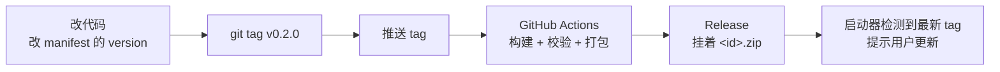

# 打包与上架商店

写完插件之后，这一页讲怎么发布，让所有用户都能在启动器里装上。

## 整体流程



**关键点：发布新版只需要打新 tag。** 商店条目不用动——下面解释为什么。

## Tag 命名（硬要求）

tag 必须是下面两种形式之一：

- `x.x.x` —— 例如 `1.0.0`、`2.3.1`
- `vx.x.x` —— 例如 `v1.0.0`、`v2.3.1`

**不要**用 `release-1.0`、`1.0`、`latest` 这类命名。版本号按数字逐段比较（`1.10.0` > `1.9.0`）。

### tag 必须和 manifest 的 version 一致

启动器判断「有没有更新」的方式是：读插件仓库**最新 Release 的 tag**，和本地已装的 `version`（来自 manifest）比较。

两者不一致会导致：

- tag 比 manifest 高 → 用户**永远**被提示有更新，装了还是提示。
- tag 比 manifest 低 → 用户**永远**收不到更新。

模板里的 `release.yml` 会在打包前拦住这种情况：

```yaml
- name: 校验 tag 与 manifest 版本一致
  run: |
    manifest_version=$(node -p "require('./manifest.json').version")
    tag="${GITHUB_REF_NAME#v}"
    if [ "$manifest_version" != "$tag" ]; then
      echo "::error::tag 是 v$tag，但 manifest.json 里写的是 $manifest_version"
      exit 1
    fi
```

## 为什么资产名不带版本号

发布出来的 zip 应该叫 **`<你的id>.zip`**，比如 `pixelmap.zip`，**不要**叫 `pixelmap-0.1.0.zip`。

因为商店索引里的下载地址写死成：

```
https://github.com/<owner>/<repo>/releases/latest/download/<你的id>.zip
```

`releases/latest` 永远指向最新那个 Release。资产名固定，这个链接就**永远有效**。

::: tip 于是就有了这条规则
**发布新版只需要打新 tag 并推送，不用回来改商店。**

如果资产名带版本号，每次发版链接都会断，就得回来改商店——这正是要避免的。
:::

## 发布流程

模板仓库已经带了 `.github/workflows/release.yml`。它做四件事：

1. 构建、类型检查
2. 校验 tag 与 manifest 的 `version` 一致
3. 打包成 `<id>.zip`（只含 `manifest.json`、`dist/`、`icon`）
4. 挂到 Release

所以发一个版本：

```bash
# 1. 改代码
# 2. 把 manifest.json 的 version 改成 0.2.0
git commit -am "0.2.0"
git tag v0.2.0
git push && git push --tags
```

等 Actions 跑完，Release 就绪。

::: warning 仓库必须是公开的
启动器从 GitHub 读你的 Release 来判断版本和下载。私有仓库读不到。
:::

## 上架到商店

第一次发布之后，把你的插件提交到商店，用户才能在启动器里搜到。

商店仓库：[Wemsur/Celestial-Plugin-Store](https://github.com/Wemsur/Celestial-Plugin-Store)

### 方式一：提 Issue（推荐）

点 **Issues → New issue → 「提交内容源」**（或「提交插件」），按表单填。

机器人会自动把它转成一个修改 `content-sources.json`（或 `plugins.json`）的 **PR**，维护者审核后合并。合并后 PR 会自动关闭对应的 Issue。

### 方式二：直接提 PR

Fork 商店仓库，在索引文件的数组里追加（或按 `id` 替换）你的条目，提 PR。

## 商店条目字段

### 内容源（`content-sources.json`）

```json
{
	"id": "example",
	"name": "示例内容站",
	"description": "一句话简介",
	"author": "你的名字",
	"github": "Wemsur/celestial-content-example",
	"repo": "https://github.com/Wemsur/celestial-content-example",
	"download": "https://github.com/Wemsur/celestial-content-example/releases/latest/download/example.zip",
	"contentTypes": ["world"],
	"tags": ["地图"]
}
```

| 字段 | 必填 | 说明 |
|---|---|---|
| `id` | ✅ | 与 `manifest.json` 一致，商店内唯一 |
| `name` | ✅ | 显示名称 |
| `github` | ✅ | `owner/repo`，用于自动检测最新 Release |
| `download` | ✅ | `https` 直链，指向打包好的 zip |
| `contentTypes` | ✅ | 提供哪些内容类型，至少一个（取值见下） |
| `repo` | 选填 | 插件主页链接 |
| `description` / `author` / `tags` / `icon` | 选填 | 元信息 |

`contentTypes` 是启动器的封闭取值，只能从七个里选：`mod`、`modpack`、`resourcepack`、`shader`、`datapack`、`world`、`skin`。它决定了你的源出现在哪些标签页下。

### UI 插件（`plugins.json`）

结构相同，但没有 `contentTypes`。

::: danger 条目里不要写 `version` 字段
版本号由启动器从最新 Release 的 tag **实时读取**。写死了反而会不一致。
:::

## 之后更新

**只打新 tag。** 商店条目不用动。

除非这些变了，那就再提一次 Issue（机器人按 `id` 覆盖已有条目）：

- `id`、名称
- 仓库地址、下载地址
- **`content_types` / `contentTypes`** —— 它决定你的源出现在哪些标签页下

## 本地验证打包结果

发布前最好确认 zip 里该有的都有。可以本地跑一遍打包逻辑：

```bash
pnpm build
zip -r example.zip manifest.json dist icon.png
unzip -l example.zip
```

应该看到 `manifest.json`、`dist/index.js`、`icon.png`（如果声明了）。**不应该**有 `src/`、`node_modules/`、`.github/`。

然后可以把这个 zip 手动装进启动器验证（见[装进启动器调试](/guide/local-install#从商店安装)）。

---

到这里就完成了。回到[实例拆解](/cookbook/)看真实插件的写法，或者去[FAQ](/faq)查报错。
