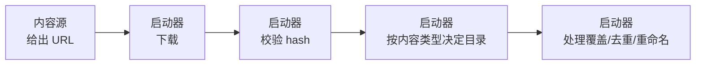
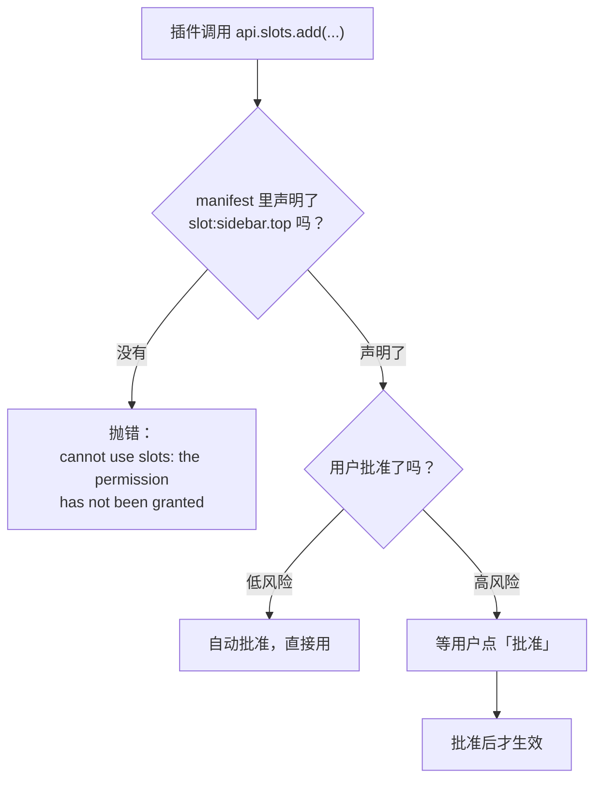

# 为什么有插件系统

要写好一个插件，先要知道启动器为什么把自己拆成这样。理解了这个，后面所有「为什么不能那样写」的问题就都不用单独记了。

## 一句话

启动器把**能扩展的地方**和**必须自己攥着的地方**分开了，中间只留一个很窄的接口。

- 能扩展的地方：一个新的**内容来源**（下载源），或者一块新的**界面**。
- 必须自己攥着的：下载、校验、决定文件装到哪个目录、覆盖策略、去重、排序。

## 内容源：为什么它不能碰文件

假设你要接一个「某某地图站」。最直觉的写法是让插件自己把地图下载下来、解压到 `saves/` 里。启动器没让你这么做。

一个内容源能做的事只有三件：

1. 告诉启动器「有什么」——搜索、浏览。
2. 告诉启动器「长什么样」——详情、版本列表。
3. 告诉启动器「文件从哪下」——给一个 URL。

剩下的全是启动器的：



这条约束在 SDK 的注释里被写成一句话：**a source can propose content, never place it**（内容源只能*提议*内容，不能*放置*内容）。

### 这么设计换来了什么

**第一，装错地方这件事从根上不会发生。** 一个模组永远进 `mods/`，一个光影永远进 `shaderpacks/`。插件作者不需要知道这些目录叫什么，也就不会写错。

**第二，危险操作只在一个地方审查。** 解压一个 zip 到磁盘上是很危险的事（zip slip、覆盖存档、塞进去一个可执行文件）。如果每个插件各写一遍，就等于有 N 份代码要审查。现在只有启动器里那一份。

**第三，插件的权限面小得多。** 内容源根本拿不到文件系统的句柄，它只有 `api.net.fetch` 和 `api.storage` 两样东西。这让「装一个陌生人的内容源」变成一个可以接受的提议。

### 这条约束落到你身上是什么样

| 你可能想做的事 | 内容源能不能做 | 正确做法 |
|---|---|---|
| 下载一个模组并装进实例 | ❌ 不能自己装 | `resolve_download()` 返回 URL，启动器装 |
| 判断这个文件该进 `mods/` 还是 `resourcepacks/` | ❌ 不用你判断 | 你在 manifest 里声明 `content_types`，启动器按类型决定 |
| 已经装了旧版，先删掉再装新版 | ❌ 不归你管 | 启动器的安装流程处理 |
| 给一个整合包解压出 200 个模组 | ⚠️ 你只列清单 | `resolveModpack()` 返回文件清单，启动器下载并解压 |
| 把站点的中文标签翻译成用户的语言 | ✅ 可以 | 见[多语言](/source/i18n) |
| 缓存站点返回的 token | ✅ 可以 | `api.storage` |

## UI 插件：为什么能力要一项项批

UI 插件跑在启动器的页面里，和启动器**共用同一个 JavaScript 环境**。这意味着它理论上能碰启动器的一切——这是很危险的位置。

所以启动器反过来做：**默认什么都不能做，每一项能力都要在 manifest 里显式声明，用户还要手动批准。**



低风险的权限（注入样式、写自己的存储、放一张卡片）装上即生效；高风险的（访问网络、读实例列表、接管顶栏、跑原生程序）必须用户点头。

### 对你写代码的实际影响

**你要假设权限随时可能没有。** 用户可能就是不批准 `hostapi:instance.list`。你的插件不能因此崩掉：

```ts
// ✅ 优雅降级：拿不到就显示「未授权」，而不是让整个插件挂掉
try {
	const instances = await api.hostApi.call('instance.list')
	count.value = instances.length
} catch {
	count.value = null // 界面上显示「未授权读取」
}
```

```ts
// ❌ 这样会让 activate() 抛错，插件的其余部分（卡片、页面）全都不工作
const instances = await api.hostApi.call('instance.list')
```

**别声明你实现不了的能力。** 声明了就会被调用——内容源那边声明 `resolve_download: true` 却返回不了地址，用户看到的是点了安装之后报错，而不是按钮灰掉。

## 两者的边界

有些事两边都碰不到，因为它们在启动器内部：

- **安装位置**：内容源管不到，UI 插件也管不到。想控制一个文件装到哪，只能通过「它是什么内容类型」间接表达。
- **实例的创建**：整合包会新建一个实例，这是启动器做的。内容源只提供「这个包需要哪个游戏版本、哪个加载器、哪些文件」。
- **用户看到的排序**：内容源给出原始下载量，启动器会乘上一个**源倍率**再排序（否则小站点的数字会被 Modrinth 淹没）。倍率是用户可调的，不是你能定的。

---

接下来：[你该写哪一种](/guide/choosing)，或者直接看[核心概念](/guide/concepts)。
