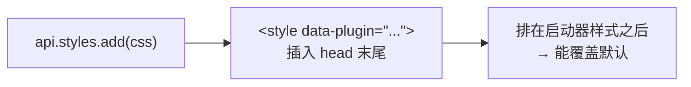

# 样式

UI 插件注入 CSS 需要 `style` 权限（低风险，自动授予）。这一页讲怎么让插件的界面和启动器看起来是一体的。

## 注入 CSS

```ts
api.styles.add(`
	.my-plugin-card {
		padding: 12px;
		border-radius: 10px;
		background: var(--color-brand);
		color: var(--color-accent-contrast);
	}
`)
```

启动器把它插入 `<head>`，**追加在启动器自己的样式之后**——所以你的规则在层叠里排在后面，能覆盖默认值。



## 用启动器的 CSS 变量

**这是让界面看起来一致的关键。** 启动器有一套主题变量，它们会跟着用户的主题（浅色/深色/自定义色相）变。你的 CSS 用它们，界面就自动跟着走。

### 最常用的

| 变量 | 用途 |
|---|---|
| `--color-brand` | 品牌色（启动器的主题色，默认绿） |
| `--color-brand-highlight` | 品牌色的半透明版本，用于选中态背景 |
| `--color-accent-contrast` | 配 `--color-brand` 的背景上的文字色（浅色主题下是白，深色下是黑） |
| `--color-text-primary` | 主要文字 |
| `--color-text-default` | 正文文字 |
| `--color-text-tertiary` | 次要文字 |
| `--color-bg` | 页面背景 |
| `--color-divider` | 分隔线 |

```css
.my-plugin-card {
	background: var(--color-surface-3);
	color: var(--color-text-primary);
	border: 1px solid var(--color-divider);
}
```

### 完整的变量组

启动器的主题变量很多，按用途分：

**表面（层级背景）**：`--surface-1` 到 `--surface-5`，数字越大越"浮在上面"。

**文本**：`--color-text-primary`（最亮）→ `--color-text-default` → `--color-text-tertiary`（最暗）。

**语义色**：`--color-red`、`--color-green`、`--color-blue`、`--color-orange`、`--color-purple`，各自还有 `-highlight`（半透明）和 `-bg`（更淡的背景）变体。

**按钮**：`--color-button-bg`、`--color-button-bg-selected`、`--color-button-text-selected`。

**加载器色**：`--color-platform-forge`、`--color-platform-fabric` 等。

::: tip 变量的值随主题变
同一个 `--color-text-primary`，在浅色主题下是深色（`#1a202c`），深色主题下是浅色（`#ffffff`）。所以你**不要**自己写死 `#333`——用变量，用户换主题时你的界面才跟着变。
:::

## 用 Tailwind 工具类

插槽组件和页面组件渲染在启动器的页面里，**启动器的 Tailwind 样式对你生效**：

```ts
h('div', { class: 'p-6 flex flex-col gap-2 text-secondary' }, [...])
```

常用的：

| 类 | 效果 |
|---|---|
| `p-6`、`p-3`、`mx-4` | 内边距 / 外边距 |
| `flex`、`flex-col`、`items-center`、`gap-2` | 布局 |
| `m-0`、`text-2xl`、`text-sm` | 字号 |
| `font-semibold`、`font-medium` | 字重 |
| `text-secondary`、`text-primary` | 文字色（映射到启动器的变量） |
| `rounded-md`、`rounded-full` | 圆角 |

::: warning 工具类里的颜色可能不是你以为的那个
`text-secondary` 之类是**启动器自己定义的**，映射到主题变量。而 Tailwind 默认的 `text-gray-500` 是写死的颜色，不会跟着主题变。

**优先用启动器定义的那几个**（`text-primary`、`text-secondary`、`bg-brand` 之类），或者直接用 CSS 变量。
:::

## 两种方式怎么选

| 场景 | 建议 |
|---|---|
| 卡片、按钮这类简单界面 | Tailwind 工具类 + 少量 `api.styles.add` |
| 复杂的自定义界面 | `api.styles.add` 注入一套自己的 CSS |
| 需要跟主题走的颜色 | 一律用 CSS 变量 |

官方 hello-world 插件的做法是**两者都用**——卡片用一个注入的 class，里面用启动器的变量：

```ts
api.styles.add(`
	.hello-world-card {
		border-radius: 10px;
		background: var(--color-brand);
		color: var(--color-accent-contrast);
	}
`)
```

```ts
h('div', { class: 'hello-world-card mx-4 my-2 p-3 text-sm font-medium' }, [...])
```

## 关于图标

插件图标用 `manifest.json` 的 `icon` 声明，是个**文件路径**（`icon.png` / `icon.svg`）。启动器按 6px 圆角方形裁切显示。

**图标不是通过 CSS 注入的**——它由启动器读你插件目录里的文件。

## 常见错误

| 现象 | 原因 |
|---|---|
| `cannot use styles: the "style" permission has not been granted` | manifest 里没声明 `style` |
| 样式不生效 | CSS 选择器没匹配上，或者被启动器的 `!important` 压过 |
| 换主题后我的界面颜色不对 | 写死了颜色值，应该用 `var(--color-...)` |
| 深色主题下文字看不见 | 用了固定的深色文字，应该用 `--color-text-*` |

---

接下来：[订阅事件](/plugin/events)。
