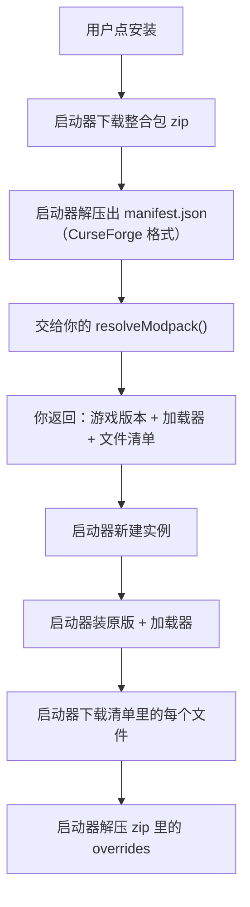

# 七种内容类型

启动器的内容类型是**封闭取值**——一共七个。你在 manifest 的 `content_types` 里声明你提供哪些，启动器就按类型决定**把文件装到哪、怎么装**。

你不需要知道目录名，也不需要写安装逻辑。这一页讲清每种类型的语义，以及哪些地方**和你想象的不一样**。

## 一览

| 取值 | 含义 | 安装位置 | 需要选实例吗 |
|---|---|---|---|
| `mod` | 模组 | 实例的 `mods/` | 是 |
| `modpack` | 整合包 | **新建一个实例** | 否（要选库） |
| `resourcepack` | 资源包 | 实例的 `resourcepacks/` | 是 |
| `shader` | 光影 | 实例的 `shaderpacks/` | 是 |
| `datapack` | 数据包 | 实例的 `datapacks/` | 是 |
| `world` | 世界（地图） | 实例的 `saves/`，**永不覆盖** | 是 |
| `skin` | 皮肤 | 启动器数据目录的 `skins/` | **否** |

## 声明多个类型

```json
"content_types": ["mod", "resourcepack"]
```

启动器的对应标签页就会把你列进去。用户可以在这两个标签页里分别搜到你。

::: tip 一个源服务多个类型时，卡片要标明类型
浏览页会把所有源的卡片合并展示。同一个源可能同时提供模组和资源包，所以每张卡片必须填对 `contentType`：

```ts
// ✅ 用请求里的类型，不要写死
toCard(item, request.contentType)

// ❌ 写死了，资源包标签页里的卡片会被标成模组
toCard(item, 'mod')
```

手动条目的源尤其要注意——官方 GitHub 源让用户在添加条目时**选类型**（`manual_entry` 里那个带 `options` 的字段），就是为了这个。
:::

## 逐个说明

### `mod` 模组

最普通的一种。文件（通常是 `.jar`）放进实例的 `mods/`。

安装时用户需要**选一个实例**。启动器会按你报告的 `gameVersions` / `loaders` 筛选出「兼容的实例」优先显示，但用户最终自己选。

### `modpack` 整合包

和其他六种**完全不同**：它不装进已有实例，而是**新建一个实例**。

安装流程是：



你只负责**第 D 步**：把整合包的 `manifest.json` 解析成文件清单。其余全在启动器里。

用户点安装时会先弹一个**选择库**的对话框（装到哪个多版本库下），然后才新建实例。

详见[整合包](/source/modpacks)。

### `resourcepack` 资源包

装进实例的 `resourcepacks/`。文件通常是 `.zip`。

### `shader` 光影

装进实例的 `shaderpacks/`。**注意拼写**：manifest 里是 `shader`（单数），目录是 `shaderpacks`（复数）。用启动器的拼写，不要自己造。

### `datapack` 数据包

装进实例的 `datapacks/`。**连写**，不是 `data_pack`。

### `world` 世界（地图）

**语义最特殊的一种。** 文件解压进实例的 `saves/`，而且：

> **永不覆盖，每次都建新副本。**

玩家的存档里可能建了几百小时的东西。装一张地图不能把它删了。所以启动器每次安装都在 `saves/` 下**新建一个带序号的目录**：

```
saves/
├── 我的世界/           ← 玩家自己的存档，不动
├── 某某地图/           ← 第一次装
└── 某某地图 (2)/       ← 装了第二次
```

你**不需要做任何事**来实现这个——但要知道用户装了两次会得到两个存档，所以别在 UI 文案里承诺「覆盖」。

启动器还会处理「zip 里套了一层目录」的情况（很多地图站打包时多套一层），自动找到真正的存档目录。

### `skin` 皮肤

**不属于任何实例。** 存在启动器自己的 `skins/` 目录里（在数据目录下，不在实例里），在皮肤页显示。

所以装皮肤时**不需要选实例**。如果你的源只提供皮肤，`resolveDownload` 之外不需要关心实例。

## 启动器替你做的事

这几种类型的安装，启动器各自处理了这些细节，你都碰不到：

| 情况 | 启动器怎么处理 |
|---|---|
| 文件名冲突 | 重命名或按策略处理 |
| 重复安装同一个内容 | 识别并提示（不是再装一份） |
| 世界地图的 zip 多套一层目录 | 自动找到真正的存档目录 |
| 整合包里的模组有重复 | 去重 |
| 下载失败 | 报错并中止，不会留下半个实例 |

## 源徽章

浏览页里每张卡片、每个详情页都会带一个**源徽章**，标明内容来自哪个源。它按这个顺序降级：

1. 你 manifest 里声明的 `icon` 图片
2. Modrinth 的 logo（只有 Modrinth 源会用）
3. `name` 的首字母，画在 `color` 色的圆角方块上

所以即使你不提供图标，用户也能认出你的内容——但提供一个图标体验会好很多。

::: tip 图标建议
用**圆角方形**（不是圆形），和启动器其他图标的语言一致。svg 或至少 256×256 的 png。
:::

## 常见错误

| 错误 | 原因 |
|---|---|
| `unknown variant \`resource_pack\`` | 用了下划线写法，应该是 `resourcepack` |
| `unknown variant \`shaders\`` | 用了复数，应该是 `shader` |
| 卡片出现在错误的标签页 | `contentType` 写死了，应该用 `request.contentType` |
| 整合包装完是空实例 | `resolveModpack` 返回的 `files` 是空的，或者 `loader` 写错了 |

---

接下来：[搜索与浏览](/source/search-browse)。
