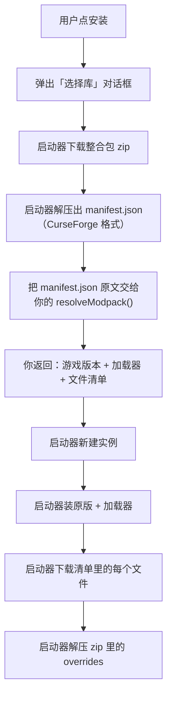

# 整合包

整合包（`modpack`）是七种内容类型里**最复杂**的一种——它不装进已有实例，而是新建一个实例。

但对内容源来说，你只需要实现**一个方法**：`resolveModpack`。剩下全是启动器的活。

```ts
async resolveModpack(manifestJson: string): Promise<ContentModpackPlan>
```

## 整个流程



**你只做第 E→F 步。** 建实例、装原版和加载器、下载每个文件、解压 overrides，全是启动器的。

## 为什么这一步交给你

整合包的 `manifest.json` 里，每个模组记的是「哪个项目的哪个文件」（CurseForge 的项目 id + 文件 id），**不是 URL**。要把它们变成可下载的 URL，得调用**你那个站点的 API**——这是你的业务。

```json
// 整合包 zip 里的 manifest.json（CurseForge 格式，节选）
{
	"minecraft": { "version": "1.20.1", "modLoaders": [{ "id": "forge-47.2.0", "primary": true }] },
	"files": [
		{ "projectID": 238222, "fileID": 4567890, "required": true },
		{ "projectID": 306612, "fileID": 4567891, "required": true }
	]
}
```

你把这些 `projectID`/`fileID` 批量换成下载地址。

## 返回什么

```ts
{
	gameVersion: string // 例如 '1.20.1'
	loader: 'vanilla' | 'forge' | 'neoforge' | 'fabric' | 'quilt'
	loaderVersion?: string // 例如 '47.2.0'
	files: {
		url: string // 文件直链
		fileName: string // 文件名
		hashSha1?: string // 可选，给了就校验
		folder?: string // 实例内目录，默认 'mods'
	}[]
}
```

| 字段 | 说明 |
|---|---|
| `gameVersion` | 新建实例用的 MC 版本 |
| `loader` | 加载器类型。**必须是这五个之一** |
| `loaderVersion` | 加载器版本，如 `47.2.0`。不填启动器会选一个 |
| `files[].folder` | 实例内的相对目录，默认 `mods`。资源包填 `resourcepacks`，光影填 `shaderpacks` |

## 完整例子（CurseForge 风格）

```ts
api.register({
	async resolveModpack(manifestJson: string): Promise<ContentModpackPlan> {
		const manifest = JSON.parse(manifestJson)

		// 1. 游戏版本
		const gameVersion = manifest.minecraft.version

		// 2. 加载器：manifest 里是 "forge-47.2.0" 这种形式，拆开
		const primary = manifest.minecraft.modLoaders.find((l: any) => l.primary) ?? manifest.minecraft.modLoaders[0]
		const [loader, loaderVersion] = splitLoader(primary.id) // "forge-47.2.0" → ['forge', '47.2.0']

		// 3. 文件清单：manifest 里只有 projectID/fileID，要批量换成 URL
		const fileIds = manifest.files.filter((f: any) => f.required).map((f: any) => f.fileID)
		const resolved = await get<any>('/mods/files', {
			method: 'POST',
			headers: { 'content-type': 'application/json' },
			body: JSON.stringify({ fileIds }),
		})

		const files = resolved.data.map((file: any) => ({
			url: file.downloadUrl,
			fileName: file.fileName,
			hashSha1: file.hashes?.find((h: any) => h.algo === 1)?.value,
		}))

		return { gameVersion, loader, loaderVersion, files }
	},
})
```

## 几个关键点

### 只需要处理 `required` 的文件

整合包的 manifest 里每个文件有 `required` 字段。**跳过 `required: false` 的**——那些是可选的，装了反而可能出问题。

### 限制文件类型

有些整合包的 manifest 里混了非模组的东西（资源包、光影）。按 `projectID` 对应的项目类型分拣，或者至少把明显不是模组的过滤掉。

### `folder` 决定装到哪

```ts
{
	url: '...',
	fileName: 'faithful.zip',
	folder: 'resourcepacks', // 不是 mods
}
```

不填就是 `mods`。

### 用批量接口

整合包动辄两三百个文件。**别一个文件一次请求**——用站点的批量接口（CurseForge 的 `/v1/mods/files` 一次能传多个 `fileIds`）。

::: warning 只请求 `required` 的文件，但别漏
过滤条件要和你返回的清单一致。返回了 `required: false` 的文件，用户会得到一个不该有的模组；漏了 `required: true` 的，实例会崩。
:::

### 加载器 id 的解析

CurseForge 的 `modLoaders[].id` 是 `forge-47.2.0` 这种连写形式，要拆开：

```ts
function splitLoader(id: string): [ContentModpackPlan['loader'], string | undefined] {
	// "forge-47.2.0" → ['forge', '47.2.0']
	const dash = id.indexOf('-')
	if (dash === -1) return ['vanilla', undefined]
	const name = id.slice(0, dash)
	const version = id.slice(dash + 1)
	const known = ['forge', 'neoforge', 'fabric', 'quilt']
	return [known.includes(name) ? (name as any) : 'vanilla', version]
}
```

注意 `neoforge` 也是连写的一个词，别拆成 `neo` + `forge`。

## 国内镜像

CurseForge 的 CDN 在国内经常很慢或不通。官方的 CurseForge 源做了镜像：把 `edge.forgecdn.net` 换成国内可访问的镜像域名。

如果你做镜像，**镜像域名也要写进 `hosts`**：

```json
"hosts": ["api.curseforge.com", "edge.forgecdn.net", "mediafilez.forgecdn.net", "mod.mcimirror.top"]
```

而且要在 `resolveModpack` 里**改写每个文件的 URL**：

```ts
function mirror(url: string): string {
	return url.replace(/^https:\/\/edge\.forgecdn\.net\//, 'https://mod.mcimirror.top/')
}
```

## 安装时的进度条

整合包的下载量很大，启动器会显示**字节级的进度条**（不是「第 12/200 个」那种）。这是启动器自己算的，你不需要做任何事。

## 常见错误

| 现象 | 原因 |
|---|---|
| 装完是空实例 | `files` 是空数组，或者全被过滤掉了 |
| 实例建了但启动报缺加载器 | `loader` 或 `loaderVersion` 不对 |
| 大量文件下载失败 | 文件 URL 的域名不在 `hosts` 里 |
| 装了不该有的模组 | 没过滤 `required: false` |
| 资源包装进了 `mods/` | 忘了给 `folder` |
| `resolveModpack` 没被调用 | manifest 里 `content_types` 没有 `modpack` |

## 参考实现

官方的 CurseForge 源有完整的 `resolveModpack` 实现，包括镜像、批量接口、加载器解析。见[拆解：CurseForge 源](/cookbook/curseforge-source)。

---

接下来：[更新检查](/source/update-check)。
