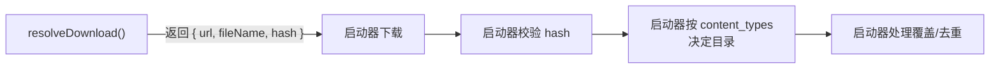

# 下载地址

`resolveDownload` 是内容源里**最重要**的方法——它是「安装」这个动作的起点。也是最能体现「提议而非放置」这条约束的地方。

```ts
async resolveDownload(
	id: string,
	versionId?: string,
	fileId?: string,
): Promise<DownloadDescriptor>
```

## 它只做一件事：给地址

```ts
{
	url: string // 必填，文件直链
	headers?: Record<string, string> // 需要 referer / cookie / UA 时
	fileName?: string // 装上之后叫什么
	hash?: { algorithm: 'sha1' | 'sha512'; value: string } // 可选，给了就校验
}
```

**你不下载文件。** 启动器拿这个描述符去下载、校验、并按内容类型决定装到哪。



## 参数

| 参数 | 什么时候有 |
|---|---|
| `id` | 总是有。你给的项目 id |
| `versionId` | 用户选了某个版本时。没选则是 `undefined` |
| `fileId` | 用户在 `versions()` 返回的 `files` 里挑了一个时 |

```ts
async resolveDownload(id, versionId, fileId) {
	// 用户从版本表选了一个版本
	if (versionId) {
		const version = await get<any>(`/version/${versionId}`)
		const file = fileId
			? version.files.find((f: any) => f.id === fileId)
			: version.files[0]
		return {
			url: file.url,
			fileName: file.filename,
			hash: file.sha1 ? { algorithm: 'sha1', value: file.sha1 } : undefined,
		}
	}

	// 没有版本概念（versions: false 的源），直接给这个项目的主文件
	const item = await get<any>(`/item/${id}`)
	return {
		url: item.download_url,
		fileName: `${item.slug}.jar`,
	}
}
```

::: tip 先处理「有没有 versionId」
很多源支持 `versions`，但用户也可能从详情页直接点安装（不选版本）。所以两个分支都要能走通。

如果站点没有版本概念，manifest 里 `versions: false`，那 `versionId` 永远是 `undefined`，只处理一个分支即可。
:::

## `url` 的要求

- **必须是完整 URL**，`https://` 开头。
- **域名必须在 `hosts` 里**——不在这里的域名下载会被拒绝。
- **重定向的目标域名也要在 `hosts` 里**。

::: warning 重定向是最容易漏的
GitHub 的 Release 下载会 302 到 `objects.githubusercontent.com`。只写 `github.com` 不够——实际下载会失败。

官方 GitHub 源的 `hosts`：

```json
"hosts": [
	"api.github.com",
	"github.com",
	"objects.githubusercontent.com",
	"release-assets.githubusercontent.com"
]
```

**测试方法**：在启动器里真的装一次，看日志里有没有域名被拒的信息。
:::

## `headers` 什么时候用

有些站点不允许直接下载，需要看起来像从它自己页面上点的：

```ts
return {
	url: file.url,
	headers: {
		referer: 'https://example.com/',
		'user-agent': 'Mozilla/5.0 (Windows NT 10.0; Win64; x64) ...',
	},
}
```

需要登录的站点，把 cookie 带上：

```ts
const cookie = await api.storage.get('cookie')
return {
	url: file.url,
	headers: cookie ? { cookie } : undefined,
}
```

::: tip 和 api.net.fetch 一样的头规则
允许 `cookie`、`referer`、`user-agent`、`authorization`；不允许 `host`、`content-length` 这类决定连接本身的头。见[网络与 hosts](/source/network#请求头)。
:::

## `fileName` 的作用

装上之后文件叫什么名字。**不填时，启动器用 URL 最后一段**。

```ts
// URL 是 https://cdn.example.com/downloads/12345 → 文件叫 "12345"，很难看
{ url: item.download_url }

// 填了就用你的
{ url: item.download_url, fileName: `${item.slug}-${item.version}.jar` }
```

建议总是填——站点 CDN 的 URL 最后一段经常是一串数字 id 或者 `download`。

## `hash` 是可选但推荐的

```ts
hash: { algorithm: 'sha1', value: file.sha1 }
```

| 情况 | 启动器的行为 |
|---|---|
| 提供了 hash | 下载后校验，不匹配就报错、不安装 |
| 没提供 | 下载后**不校验**，记录为「未验证」 |

算法只支持 `sha1` 和 `sha512`。CurseForge 给的是 sha1，Modrinth 用 sha512——照站点给的填。

::: danger 别伪造 hash
不提供 hash 是允许的（站点可能确实没有）。但**不要编一个**——校验失败会让安装直接失败，用户会以为你的源坏了。
:::

## 文件名的坑

站点给的原始文件名经常带着奇怪的东西，直接当 `fileName` 会出问题：

```ts
// 站点给的： "my-mod-1.0.0.jar?download=1"  ← 带查询串
// 或者：     "my mod [1.20.1].jar"          ← 带空格方括号

fileName: decodeURIComponent(file.fileName.split('?')[0])
```

至少要把 URL 查询串去掉。启动器会处理路径安全（不会让文件名逃出目标目录），但文件名本身难看/冲突还是会给用户添麻烦。

## 特殊：整合包

整合包**不走这个方法的常规路径**。整合包的文件下载是启动器在解析完 `resolveModpack` 的文件清单后自己做的。

不过 `resolveDownload` 仍然需要——它负责给出**整合包 zip 本身**的地址。启动器下载这个 zip，解压出里面的 `manifest.json`，再交给你的 `resolveModpack`。

```ts
async resolveDownload(id, versionId) {
	// 给的是「整合包 zip」的地址，不是里面每个模组的地址
	const file = await getVersionFile(versionId)
	return { url: file.url, fileName: file.filename }
}
```

详见[整合包](/source/modpacks)。

## 测试方法

装一次试试。启动器会在日志里打印：

```
Downloading https://cdn.example.com/... → my-mod-1.0.0.jar
```

如果域名被拒：

```
Content source 'example' did not declare access to 'cdn.example.com'
```

如果 hash 校验失败：

```
Hash mismatch for my-mod-1.0.0.jar
```

## 常见错误

| 现象 | 原因 |
|---|---|
| 安装按钮是灰的 | manifest 里 `resolve_download` 是 `false` |
| 点了安装报「域名未声明」 | 下载 URL 的域名不在 `hosts` 里 |
| 下载失败但域名对 | 是重定向到的域名没写进 `hosts` |
| 装上的文件名是一串数字 | 没填 `fileName` |
| hash 校验失败 | hash 值不对，或者站点更新了文件没更新 hash |
| 整合包装完是空实例 | `resolveModpack` 返回的清单为空 |

---

接下来：[侧边栏筛选](/source/filters)。
